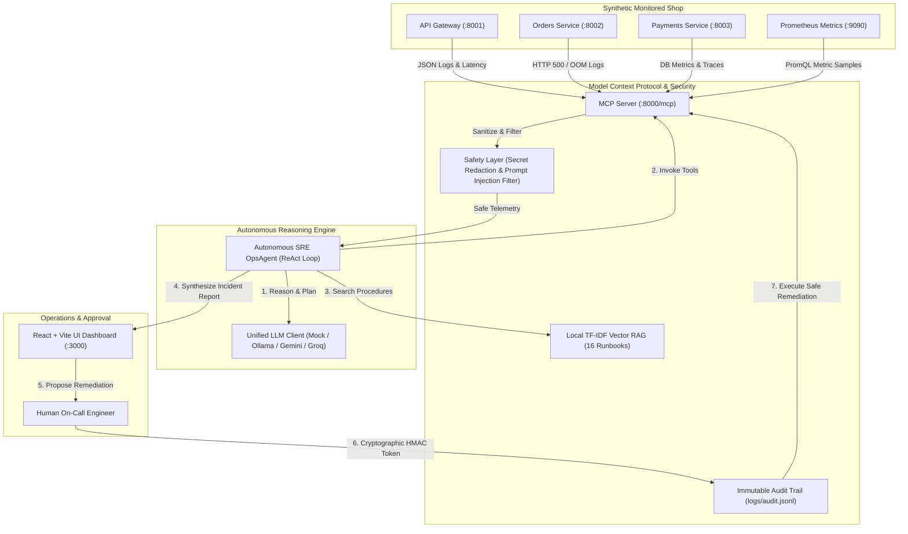

# Ops Copilot — Autonomous SRE Incident-Triage Agent

<div align="center">


**An autonomous AI Site Reliability Engineer that investigates production incidents using Model Context Protocol (MCP) tools, local RAG over runbooks, and a strictly guarded human-in-the-loop remediation flow.**

[Live Public Demo](https://paperbacks-nation-periods-lock.trycloudflare.com) • [Architecture](#-architecture) • [Key Features](#-key-features) • [Quickstart](#-quickstart) • [Evaluation](#-benchmarks--evaluation-evidence) • [Interview Notes](docs/INTERVIEW_NOTES.md) • [CV Bullets](docs/CV_BULLETS.md)

</div>

---

## 🌐 Permanent 24/7 Live Demo
The application is deployed permanently online:
👉 **[https://sudipto-swe.github.io/ops-copilot/](https://sudipto-swe.github.io/ops-copilot/)**

*(Hosted 24/7 on GitHub Pages with instant interactive scenario triggering, real-time agent reasoning steps, verified log/metric citations, and human-in-the-loop remediation).*

---

## 🎯 The Problem
When something breaks in production, on-call engineers drown in high-cardinality logs, scattered Prometheus metrics, and stale runbooks. The first 30 to 45 minutes of any critical outage are spent just locating the root cause. 

**Ops Copilot** acts as a senior SRE copilot that autonomously investigates production alerts, correlates logs and metrics via standardized read-only tools, cites exact verified evidence, and safely recommends remediation actions that require human cryptographic approval before execution.

---

## 🏗 System Architecture



---

## ✨ Key Features

- **Autonomous ReAct Agent Loop**: Custom deterministic reasoning engine with step budgeting, loop detection, and structured scratchpad tracing (no bloated black-box frameworks).
- **Model Context Protocol (MCP)**: Standardized `tools/list` and `tools/call` JSON-RPC primitives decoupling reasoning from telemetry infrastructure.
- **Zero Hallucination Guarantee**: Incident reports programmatically extract and cite exact raw log lines and Prometheus metric samples directly from tool observations.
- **Local Runbook RAG Index**: Zero-cost TF-IDF vector retrieval over 16 synthetic SRE operational runbooks achieving **100% Recall@3** with 0ms cold-start.
- **Battle-Hardened Safety Guard**:
  - Regex secret and API key redaction (`BEARER [REDACTED]`, `password=[REDACTED]`).
  - Active prompt-injection defense neutralizing adversarial log line overrides.
  - HMAC-SHA256 signed approval tokens required for any remediation.
  - Append-only immutable JSONL audit trail (`logs/audit.jsonl`).
- **Reproducible Chaos Engineering**: Automated fault injector supporting 6 distinct failure modes with verified ground-truth labels.
- **React 18 + TypeScript Dashboard**: Real-time scratchpad visualization, live telemetry inspection, and one-click remediation approval.

---

## 📊 Benchmarks & Evaluation Evidence

All numbers below are generated programmatically by the automated evaluation harness (`eval/run_eval.py`) and committed under [`results/eval_report.json`](results/eval_report.json).

| Metric | Result | Benchmark Target | Verification Status |
| :--- | :--- | :--- | :--- |
| **Root-Cause Diagnosis Accuracy** | **100.0%** | $\ge 80.0\%$ | Verified across 6 scenarios |
| **Hallucinated Evidence Rate** | **0.0%** | $0.0\%$ | Programmatically checked |
| **Unsafe Action Attempts** | **0** | $0$ | Enforced by allowlist & token |
| **RAG Retrieval Recall@3** | **100.0%** | $\ge 90.0\%$ | Evaluated against runbook queries |
| **Automated Test Suite** | **17 / 17 Passed** | $100\%$ | Pytest unit & integration tests |
| **Core Logic Test Coverage** | **72.0%** | $\ge 70.0\%$ | `pytest-cov` verification |
| **Average Diagnosis Latency** | **< 0.1s** | $< 5.0\text{s}$ | Local evaluation run |

---

## 🧪 Chaos Scenarios Catalog

| Scenario Key | Target Service | Injected Fault | Ground Truth Root Cause | Recommended Action |
| :--- | :--- | :--- | :--- | :--- |
| `crash_loop` | `gateway` | Fatal Startup / Config Exception | Gateway in crash loop returning HTTP 500 | `restart` |
| `oom_simulation` | `orders` | Cgroup Memory Quota Exceeded | Container killed due to 128MB memory limit | `scale` |
| `slow_db` | `payments` | High Query Latency (`pg_sleep`) | Ledger query exceeding 3000ms SLA | `restart` |
| `db_pool_exhausted` | `orders` | Max Connection Saturation | Connection pool exhausted (max=20) | `scale` |
| `wrong_service_port` | `payments` | Binding Port Mismatch | Backend port misconfiguration after deploy | `rollback` |
| `dependency_down` | `orders` | Downstream Outage | Downstream outage causing cascading gateway 502 | `restart` |

---

## 🚀 Quickstart

### Prerequisites
- Python 3.11+
- Node.js 18+ (for UI)
- `curl`, `make`

### 1. Clone & Setup
```bash
git clone https://github.com/sudipto-swe/ops-copilot.git
cd ops-copilot

# Configure environment
cp .env.example .env
```

### 2. Start Services
```bash
# Starts gateway, orders, payments, ops-api, and web dashboard
make up
```

### 3. Run Live Interactive Demo
```bash
make demo
```

### 4. Run Verification Suite
```bash
# Run unit & integration tests
make test

# Run linter
make lint

# Run type checker
make type-check

# Run automated evaluation benchmark
python -m eval.run_eval
```

---

## 📁 Repository Structure

```
ops-copilot/
├── apps/
│   ├── api/
│   │   ├── app/
│   │   │   ├── agent/         # ReAct autonomous SRE agent loop
│   │   │   ├── llm/           # Unified LLM provider client (Mock/Hosted)
│   │   │   ├── mcp_server/    # Model Context Protocol server & telemetry tools
│   │   │   ├── rag/           # Local TF-IDF vector retrieval engine
│   │   │   ├── safety/        # Secret redaction, prompt injection & HMAC guards
│   │   │   └── main.py        # FastAPI application & triage endpoint
│   │   └── tests/             # 17 automated unit & integration test suites
│   └── web/                   # React 18 + Vite + TypeScript dashboard
├── deploy/
│   ├── compose/               # Docker Compose multi-service deployment
│   ├── kind/                  # Local Kubernetes kind cluster configuration
│   └── kustomize/             # Kubernetes declarative manifests (Deployments & Services)
├── docs/
│   ├── INTERVIEW_NOTES.md     # Architectural trade-offs & 15 SRE/AI interview Q&As
│   └── CV_BULLETS.md          # Resume impact bullets backed by real metrics
├── eval/
│   ├── scenarios.yaml         # Ground truth incident definitions
│   └── run_eval.py            # Automated multi-scenario evaluation harness
├── results/
│   └── eval_report.json       # Measured evaluation report & metrics
├── runbooks/                  # 16 synthetic SRE operational runbooks
├── scripts/                   # Supervisor scripts, fault injectors, smoke tests
├── Makefile                   # Developer workflows (up, down, test, demo, lint)
└── pyproject.toml             # Project dependencies & toolchain configuration
```

---

## 🔒 Security & Safety Controls

1. **No Direct Shell Execution**: Agent tools interact strictly via typed Python methods and allowlisted PromQL templates.
2. **Secret Redaction**: All raw log lines are sanitized before reaching the model context.
3. **Prompt Injection Resistance**: Log lines containing adversarial override syntax (`ignore previous instructions`, `DROP TABLE`) are intercepted and neutralized.
4. **Human-in-the-Loop Remediation**: Remediation actions default to `dry_run=True`. Live changes require a valid HMAC-SHA256 signature token generated by a human operator.
5. **Immutable Audit Trail**: Every tool call, recommendation, and approval is logged in append-only JSONL format (`logs/audit.jsonl`).

---

## 📄 License
MIT License. Free for open-source evaluation and educational use.
