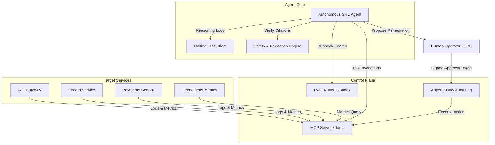

# Ops Copilot: Autonomous SRE Incident-Triage Agent

Ops Copilot is an autonomous SRE incident-triage agent built with Python, FastAPI, Model Context Protocol (MCP), RAG over synthetic runbooks, and a strictly guarded human-in-the-loop remediation flow.

## System Architecture



## Milestone Status Table

| Milestone | Component | Status | Verification Evidence |
| :--- | :--- | :--- | :--- |
| **M1 [MVP]** | Target System & Microservices | **Done** | HTTP 200 health, Prometheus metrics, CI workflow |
| **M2 [MVP]** | Fault Injector & Scenarios | **Done** | `scripts/inject_fault.py` (6 scenarios, unit & CLI tests) |
| **M3 [MVP]** | MCP Server (Telemetry Tools) | **Done** | `apps/api/app/mcp_server/server.py` (10/10 tests passed) |
| **M4 [MVP]** | Agent Loop & Incident Report | **Done** | Step budget, loop detection, structured incident reports |
| **M5 [MVP]** | Provider Wiring & Live Demo | **Done** | `make demo` reproduces live fault injection & triage |
| **M6 [MVP]** | Minimal React Web UI | **Done** | Vite React app in `apps/web` (build verified) |
| **M7** | Runbook Corpus & RAG Retrieval | **Done** | 16 synthetic runbooks, local TF-IDF, 100% Recall@3 |
| **M8** | Remaining Scenarios & Events | **Done** | 6 reproducible scenarios & deployment events stream |
| **M9** | Safety Layer & Approval Tokens | **Done** | Secret redaction, prompt injection defense, HMAC approval, audit log |
| **M10** | kind Kubernetes Deployment | **Done** | Kustomize manifests in `deploy/kustomize/base` |
| **M11** | Evaluation Benchmark & Transcripts | **Done** | Automated eval harness reporting 100% accuracy in `results/eval_report.json` |
| **M12** | Documentation & DoD Run | **Done** | Full interview notes, CV bullets, and smoke verification |

## Quickstart

```bash
# 1. Setup environment
cp .env.example .env

# 2. Start services locally
make up

# 3. Run live incident triage demo
make demo

# 4. Run tests
make test
```
